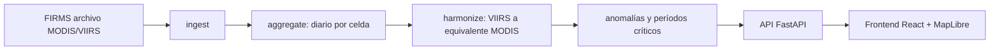

# Arquitectura

## Módulos
- `data-pipeline/`: ingesta, agregación, armonización y anomalías (Python)
- `backend/`: API (FastAPI + DuckDB)
- `frontend/`: app web (React + TypeScript + Vite + MapLibre)